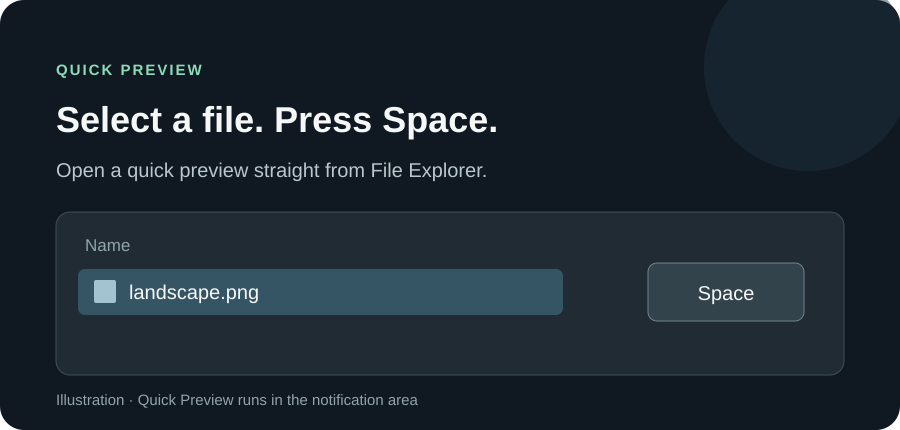
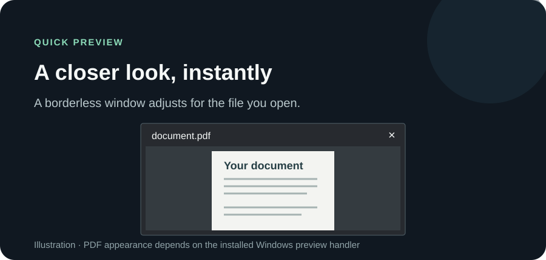
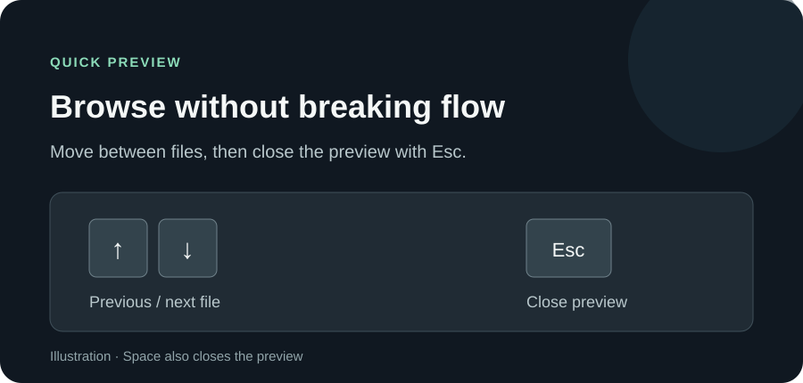

# Quick Preview for Windows

A small native Win32 tray application inspired by Quick Look on macOS. Select a file in Windows File Explorer and press **Space** to open a borderless, always-on-top preview. Use the arrow keys to move between files, and press **Esc** or **Space** to close the preview.

Quick Preview is written in C++ and does not require .NET. Images and text files have built-in previews. PDF and other formats use preview handlers installed on Windows; availability and rendering depend on the installed handler. Folio may be used when it provides a registered Windows PDF preview handler.

## At a glance

These illustrations show how Quick Preview works in File Explorer. PDF appearance depends on the Windows preview handler installed on your computer.







## Download

Download [QuickPreview-Windows-x64.zip](https://github.com/ilantwig/quick-preview-windows/releases/latest), extract it, and run QuickPreview.exe. Windows 10 or 11 x64 is required.

## Use

Run `QuickPreview.exe`. The application stays in the notification area; its tray menu provides an optional **Start at sign-in** setting and an Exit command. In File Explorer, select one file, then press Space. Drag the preview by its title area to move it. The window adjusts its size for images and PDFs.

Supported directly: PNG, JPEG, GIF, BMP, ICO and TIFF images; common text, source-code and configuration files. Other file types require an installed Windows preview handler. This app targets Windows 10 or 11 on x64 and uses File Explorer's selection; other file managers and the desktop are not supported.

## Build

In PowerShell, run:

```powershell
./scripts/setup-toolchain.ps1
./build.ps1
```

The setup script downloads a pinned LLVM-MinGW release and verifies its SHA-256 hash. The executable is written to `dist/QuickPreview.exe`. To use an existing LLVM-MinGW compiler, pass its path with `-Compiler`.

## License

MIT. See [LICENSE.txt](LICENSE.txt).

This is an unsigned build, so Windows may show an unknown publisher prompt. PDF rendering depends on the registered Windows preview handler; installing a PDF reader does not necessarily install one. See [third-party notices](THIRD_PARTY_NOTICES.md) for toolchain licenses.


